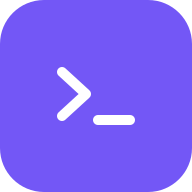
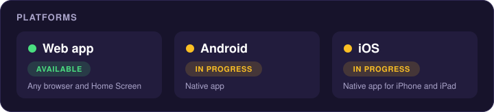

<p align="center">
  
</p>

<h1 align="center">RelayDeck</h1>

<p align="center">
  Watch and drive the coding agents and shells running on your Mac, from your phone, tablet or browser.
</p>

<p align="center">
  <a href="LICENSE">MIT License</a> ·
  <a href="docs/runbooks/install.md">Install guide</a> ·
  <a href="docs/runbooks/companion.md">Operations</a>
</p>

---

RelayDeck is a remote control for [Herdr](https://herdr.dev), the terminal workspace manager for AI coding
agents. Herdr keeps your agents and shells running on your Mac; RelayDeck lets you follow them, answer them
and start new ones from anywhere on your private network.

Everything runs on your own Mac. A small **companion** process bridges your devices and Herdr. There is no
RelayDeck cloud service and no account to create.

## Features

- **Console**: every Herdr space, agent and shell at a glance, with live status (working, blocked, done).
- **Real terminals**: full terminal rendering with selection, copy, safe paste, control keys and a
  keyboard toolbar built for phones.
- **Three ways to type**: an agent composer for writing prompts, direct input for answering an agent's
  question, and an ordinary shell terminal. Unsent drafts are kept when you switch.
- **Usage**: tokens, estimated cost and plan limits per tool and per Herdr space, read from each tool's own
  local logs, with hourly, 7-day, 30-day and 90-day charts.
- **Notifications**: a push notification when an agent is blocked or finished (Web Push, per-device
  choices).
- **Runs anywhere you are**: a web app for any browser, installable to the iPhone or iPad Home Screen.
  Native Android and iOS apps are in progress (see [Native apps](#native-apps-in-progress)).

## How it stays private

- The companion listens on **loopback only** (`127.0.0.1`) and opens **no inbound port** on your Mac or
  router.
- Devices reach it through a **tailnet-only HTTPS address** from `tailscale serve`, for example
  `https://your-mac.your-tailnet.ts.net:8445`. Tailscale Funnel (public exposure) is refused.
- Every device must be **approved on the Mac** with a matching pairing code before it gets in.
- Usage data is read from local files and stays in a local database. Only numbers are kept; conversation
  text is never stored or sent anywhere.

## Requirements

| What | Version / notes |
|---|---|
| macOS | Apple silicon or Intel |
| [Herdr](https://herdr.dev) | Protocol 22 (developed against 0.9.1), running on the Mac |
| [Tailscale](https://tailscale.com) | Logged in, with **MagicDNS** and **HTTPS certificates** enabled for your tailnet |
| Python | 3.13 (installed automatically by `uv` with `--managed-python`) |
| [uv](https://docs.astral.sh/uv/) | Any recent version |
| Devices | A browser on your tailnet, or the iPhone/iPad Home Screen web app |
| Web app build | Flutter 3.44.8 at `~/flutter/3.44.8` (see step 4); nothing is downloadable yet |

## Install

There are no release downloads yet: you install the companion from source and build the web app
yourself. Steps 1 to 6 give a working host; the full walkthrough with every option is
[docs/runbooks/install.md](docs/runbooks/install.md).

### 1. Install the companion

From the public repository at the first public tag:

```sh
uv tool install --managed-python --python 3.13 \
  "relaydeck[companion] @ git+https://github.com/Hybridhash/relaydeck@v0.2.1"
relaydeck --version
```

Or from a local clone (needed for step 4 anyway):

```sh
git clone https://github.com/Hybridhash/relaydeck.git
cd relaydeck
git checkout v0.2.1
uv tool install --managed-python --python 3.13 ".[companion]"
```

The `companion` extra carries the server parts (FastAPI, uvicorn and the Flet web mount). Always install
it on the Mac.

### 2. Run setup

```sh
relaydeck setup            # interactive: creates the private config, checks Herdr and Tailscale,
                           # offers usage sources for the coding CLIs it finds
relaydeck setup --check    # read-only readiness report (10 checks with the next step for each)
```

Setup never prints secrets. It asks before every change: creating `~/.config/relaydeck/` (owner-only)
and `companion.toml` when they are missing; the usage hook, usage sources and the `tailscale serve`
mapping are applied only after you confirm (`--yes` approves the Serve mapping without prompting).
A full example config is in
[examples/companion.toml](examples/companion.toml).

### 3. Provide the secret files and enroll the connector

Setup does not create credentials or enroll the connector, so the host is not ready after step 2.
Follow these parts of the install guide:

1. Create the two secret files named in `companion.toml` (`cookie_secret_file`, `cursor_secret_file`): mode
   0600, each at least 32 bytes, different from each other, provided through a secure channel
   ([install guide §3](docs/runbooks/install.md#3-create-the-private-configuration)).
2. Enroll the connector: `relaydeck-connector keygen`, `relaydeck-gateway issue-enrollment`, then
   `relaydeck-connector enroll` ([install guide §6](docs/runbooks/install.md#6-enroll-the-connector-keygen--issue-enrollment--enroll)).
   These tools come from the checkout (`uv run ...` inside the clone).

### 4. Build and install the web app

The web bundle is built from the clone with the repository script. It needs the clone's dev environment
and Flutter 3.44.8 at `~/flutter/3.44.8` (Flet looks for it there):

```sh
cd relaydeck
uv sync --locked --extra companion --group dev
scripts/build_web_client.sh ~/relaydeck-web
relaydeck web install ~/relaydeck-web
```

### 5. (Optional) Herdr plugin

The Herdr plugin adds **Set up**, **Pair a device** and **Status** actions in Herdr. It is optional:
the same commands are available from the `relaydeck` CLI. Install RelayDeck first (step 1), then:

```sh
herdr plugin install Hybridhash/relaydeck/plugin --ref v0.2.1
```

Herdr shows a preview of the manifest and commands before confirming. To remove it later:
`herdr plugin uninstall relaydeck`.

### 6. Start

```sh
relaydeck start --connect-herdr
```

To start it automatically at login (per user, no root):

```sh
relaydeck service install --yes --load
```

### 7. Pair a device

Open the private address (for example `https://your-mac.your-tailnet.ts.net:8445`) on the device, then on
the Mac:

```sh
relaydeck pairing open --ttl-seconds 120
relaydeck pairing list
relaydeck pairing approve --code <XXX-XXX>
```

**Approve only when the code matches exactly what the device shows.** A paired device stays signed in for
up to 30 days after its last use. The sign-in survives a companion restart only when durable sign-ins are
enabled (`RELAYDECK_DURABLE_SIGNINS=1` and the Mac key store available; see
[companion operations](docs/runbooks/companion.md)); otherwise the device must pair again after a restart.

On iPhone or iPad, use Safari's **Share → Add to Home Screen**, open RelayDeck from the Home Screen, then
tap **Get notifications** to receive alerts.

### Native apps (in progress)

<p align="center"></p>

Native Android and iOS apps are in progress and not yet released. Until then, use the web app above on
any device. Developers can build the Android app from source with `scripts/build_native.py`
(`stage --platform android`, then `build --platform android --run`); pins and build notes are in
[patches/native-runtime-pins/README.md](patches/native-runtime-pins/README.md).

## Daily use

With the companion running, open the private address on any paired device. The Console lists every
agent and shell; open one to read its terminal, send a prompt or answer a blocked agent. Check on the
companion from the Mac with `relaydeck status`, stop it with `relaydeck stop`, and start it again with
`relaydeck start --connect-herdr` (or let the login service do it).

## Updating

```sh
uv tool install --managed-python --python 3.13 --force \
  "relaydeck[companion] @ git+https://github.com/Hybridhash/relaydeck@<new-tag>"
relaydeck --version
```

Rebuild and reinstall the web bundle from the same tag (step 4), then
`relaydeck stop && relaydeck start --connect-herdr`. An install pinned to a tag is not moved by
`uv tool upgrade`; reinstall with the new tag as shown.

Release files, when published, are signed with [minisign](https://jedisct1.github.io/minisign/). Verify one
with the public key in [`minisign.pub`](minisign.pub): `minisign -Vm <file> -p minisign.pub`.

## Uninstall

```sh
relaydeck service uninstall --yes --unload      # only if you installed the login service
relaydeck stop
tailscale serve --https=8445 off                # removes the private address mapping
uv tool uninstall relaydeck
rm -rf ~/.config/relaydeck "$HOME/Library/Application Support/RelayDeck"   # config, sign-ins, usage data
```

## Troubleshooting

- `relaydeck setup --check` prints a read-only readiness report with the next step for each check.
- `relaydeck-companion doctor` reports the companion, Herdr socket, Tailscale and pairing state as JSON
  (`doctor --probe-private` also tests the private HTTPS address).
- **Usage limits stopped updating, or the Usage screen says "Setup needed"**: run `relaydeck usage doctor` to see
  why for each tool. If a tool's settings file was replaced, `relaydeck usage repair` puts back only RelayDeck's
  setting; it shows what it will change and asks first, keeps every other field, and never overwrites a status
  line you configured yourself.
- Logs for the login service are in `~/Library/Logs/RelayDeck/`.
- A device that cannot reach the address needs to be signed in to the same tailnet; the address is never
  public.

## Usage tracking

`relaydeck setup` offers each supported coding CLI it finds on your Mac as a usage source. Each tool shows
only what it really provides:

- **Tokens and estimated cost** from the tool's own local session logs.
- **Credits** for credit-metered tools.
- **Plan limits** (percent used and reset time) where the tool exposes them. For tools that show limits
  only on their own `/usage` screen, a refresh button reads them on demand.

RelayDeck reads these local files itself and stores only numbers, never conversation text. Plan limits come from
sources you enable: a tool's own cached status (through an optional hook that setup offers to install) or,
for tools that provide one, an on-demand query that runs that tool's own local command under your existing
login. RelayDeck does not store vendor credentials or send usage data to any vendor.

## Development

```sh
uv sync --locked --extra companion --group dev
uv run pytest -q
uv run ruff check . && uv run ruff format --check .
uv run mypy src
```

Local dev server with synthetic sessions (no Herdr needed):

```sh
uv sync --locked --extra companion --group dev
uv run python -m relaydeck.client.serve --dev-secret --dev-login --dev-demo-sessions
```

Native Android and iOS builds (in progress): see [patches/README.md](patches/README.md) and
`scripts/build_native.py`.

## Documentation

- [Install guide](docs/runbooks/install.md)
- [Companion operations](docs/runbooks/companion.md)
- [Device pairing](docs/runbooks/device-pairing.md)
- [All runbooks](docs/runbooks/)
- [Third-party software and licences](docs/acknowledgements.md)

## License

RelayDeck is released under the [MIT License](LICENSE). Third-party components keep their own licences;
see [docs/acknowledgements.md](docs/acknowledgements.md).
